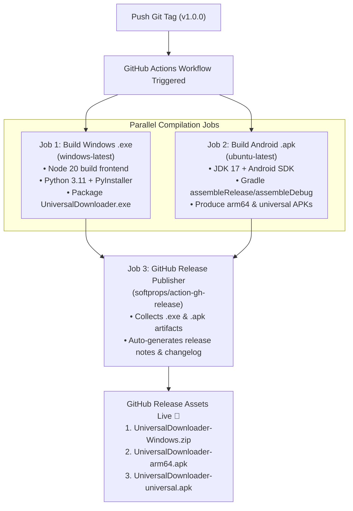

# Design Specification: GitHub Repository Setup & Standalone Windows Desktop .exe Builder

**Author:** AI Agent (Antigravity)  
**Date:** 2026-11-09  
**Status:** In Review (Brainstorming Phase)  
**Target:** Universal Media Downloader (Desktop & Mobile)

---

## 1. Intent & Context

Universal Media Downloader has successfully evolved from a local prototype into a dual-platform product:
1. **Desktop Engine**: FastAPI backend + React Vite frontend with Funimated tactile aesthetic, anti-slop design, and advanced extractors (YouTube, TikTok photos/videos, Instagram carousels, Twitter/X).
2. **Mobile Native**: 100% on-device Android application built with Kotlin, Jetpack Compose, youtubedl-android, FFmpeg, and seamless share sheet integration.

To make the project ready for public release, open-source sharing, and non-technical end users, we need:
1. A clean, standardized **GitHub Repository architecture** with proper hygiene, automated multi-platform CI/CD release pipelines, and documentation.
2. A **Standalone Windows `.exe` Builder** that packages the desktop application into a single executable featuring a native application window (via PyWebView / Edge Chromium WebView2), eliminating the need for Python, Node.js, or command prompt launcher scripts on user machines.

---

## 2. Goals, Non-Goals, and Anti-Goals

### Goals
- **Native Desktop Experience (Option A):** Package the backend (FastAPI) and built frontend (React) into a single standalone `.exe` (`UniversalDownloader.exe`) that launches a dedicated native application window using Windows WebView2 without opening browser tabs or terminal consoles.
- **1-Click Local Build Script:** Provide `desktop/build_exe.bat` to automate the local compilation of the `.exe` from source.
- **Repository Sanitization & Git Initialization:** Clean untracked caches, build outputs, and generate an airtight `.gitignore` covering Python, Node, Android/Gradle, and OS artifacts.
- **Multi-Platform CI/CD Release Pipeline:** Create `.github/workflows/release.yml` that automatically builds both the Windows `.exe` and Android `.apk` files upon pushing a version tag (e.g., `v1.0.0`) and publishes a GitHub Release with direct download links.
- **Showcase README.md:** Write an engaging, developer- and user-friendly README with badges, screenshots, architecture diagrams, platform feature matrix, and installation guides.

### Non-Goals
- **macOS / Linux Desktop Packaging:** Focusing exclusively on Windows `.exe` for desktop and Android `.apk` for mobile in this milestone.
- **Cloud Proxy / Server Infrastructure:** Maintaining 100% client-side/on-device privacy and execution.
- **Inno Setup Installer Wizard (for now):** Delivering a portable standalone `.exe` first. An optional installer can be added in a future phase if needed.

### Anti-Goals
- **Bloated Repository History:** Avoid committing `node_modules`, `venv`, `.gradle`, or pre-built binaries into Git.
- **Requiring User Dependencies:** The final `.exe` must not require the user to have Python, pip, Node, or npm installed.
- **Breaking Tactile Funimated Tokens:** The native window must preserve full CSS animation performance, spring physics, and keyboard/mouse ergonomics.

---

## 3. Approaches Considered & Trade-offs

| Approach | Description | Pros | Cons | Decision |
|---|---|---|---|---|
| **Approach 1: Standalone Native Window via PyWebView (Option A)** | Embeds FastAPI in a daemon thread and launches a native Edge Chromium (WebView2) window using `pywebview`. Packaged with PyInstaller. | Feels like a real desktop application (no browser tabs, no URL bar), single-process lifecycle, native window framing, custom icon. | Requires `pywebview` dependency during build. | **Selected (Approved by User)** |
| **Approach 2: Browser Launcher Portable .exe (Option B)** | PyInstaller packages FastAPI and calls `webbrowser.open("http://127.0.0.1:8000")`. | Simpler build configuration. | Opens a tab in user's browser, lacks native desktop feel, leaves orphan processes if user closes browser without stopping app. | Rejected |
| **Approach 3: Electron / Tauri Wrap** | Replaces Python launcher with Electron or Tauri shell invoking Python backend. | Rich native OS APIs. | Adds significant build complexity, requires multiple toolchains (Rust or heavy Electron), increases binary size. | Rejected for this milestone |

---

## 4. Detailed Architecture & Design

### 4.1. Desktop Native Window Entrypoint (`desktop/backend/desktop_app.py`)
To achieve Option A, a dedicated desktop wrapper script will be introduced:
- **FastAPI Threading:** Runs the Uvicorn/FastAPI server in a background daemon thread on a localhost port (`127.0.0.1:8765`).
- **WebView2 Window:** Uses `webview.create_window` to open the native window pointing to `http://127.0.0.1:8765`:
  - Title: `"Universal Media Downloader"`
  - Dimensions: Width `1120`, Height `780`, Min Size `(880, 620)`
  - Background color: Matches `FunimatedBg` (`#FFFDF7`)
  - Engine: Explicitly uses `gui='edgechromium'` on Windows
- **Lifecycle & Shutdown:** When the `pywebview` window is closed by the user, the application cleanly terminates the FastAPI thread and exits.

### 4.2. PyInstaller Specification (`desktop/universal_downloader.spec`)
- **Distribution Mode (Builder Call):** Directory distribution (`--onedir`) packaged into `UniversalDownloader-Windows.zip`. This ensures instantaneous startup (<1s) without cold extraction lag into `%TEMP%`, eliminates antivirus heuristics false-positives, and allows clean adjacent placement of `ffmpeg.exe` and `ffprobe.exe`.
- **FFmpeg Strategy (User Chosen: Pilihan 1):** `ffmpeg.exe` and `ffprobe.exe` are bundled directly alongside `UniversalDownloader.exe` in the release zip. In `desktop/backend/downloader.py` and `config.py`, the engine automatically detects adjacent `ffmpeg.exe` and sets `ffmpeg_location` to the application directory. Both `desktop/build_exe.bat` and GitHub Actions will download official static FFmpeg binaries if not already present in the build directory.
- **Data Bundling:**
  - `desktop/frontend/dist` -> `frontend/dist` (serves static UI without needing Node).
- **Hidden Imports:** Explicitly includes `uvicorn`, `fastapi`, `curl_cffi`, `yt_dlp`, `requests`, `engineio`, `multipart`, and `webview`.
- **Windowed Mode:** `--noconsole` flag enabled to suppress the black console window.
- **Icon:** Funimated lightning icon (`desktop/icon.ico`).

### 4.3. Frozen Mode Handling & In-App Engine Update (Builder Call)
- When running in frozen mode (`getattr(sys, 'frozen', False)`):
  - In-app engine updates via `pip` are safely bypassed.
  - The endpoint `/api/update-engine` checks the GitHub Releases API for the latest Universal Downloader release and returns a status prompt directing users to the 1-click update if available.

### 4.4. 1-Click Local Build Script (`desktop/build_exe.bat`)
A robust batch script that runs the entire build process locally:
1. Validates Python and Node.js environments.
2. Builds the frontend React app (`npm run build` in `desktop/frontend`).
3. Installs build requirements (`pyinstaller`, `pywebview`).
4. Executes PyInstaller with the spec file.
5. Verifies the output in `desktop/dist/UniversalDownloader/`.

---

## 5. GitHub Repository & CI/CD Pipeline

### 5.1. Git Hygiene & `.gitignore`
A comprehensive root `.gitignore` will be configured to cover:
- **Python:** `venv/`, `__pycache__/`, `*.pyc`, `*.pyo`, `*.pyd`, `*.spec` (spec can be committed, build folders ignored), `dist/`, `build/`.
- **Node / Frontend:** `node_modules/`, `desktop/frontend/dist/`, `.vite/`, `*.local`.
- **Android / Gradle:** `mobile/.gradle/`, `mobile/app/build/`, `mobile/build/`, `local.properties`, `*.apk`, `*.aab`.
- **OS & IDE:** `.idea/`, `.vscode/`, `Thumbs.db`, `desktop.ini`, `.superpowers/`.

### 5.2. Automated CI/CD Workflow (`.github/workflows/release.yml`)
The workflow triggers on release tags (`v*`) or manual dispatch (`workflow_dispatch`):
- **Android APK Signing (Builder Call):** The CI runner dynamically generates a self-signed release keystore (or uses repository secrets `KEYSTORE_BASE64` if configured) to sign the APKs using `apksigner`/`zipalign`, guaranteeing the resulting `UniversalDownloader-arm64.apk` and `universal.apk` can be installed on any physical Android device immediately without "App not installed" signature errors.

### 5.3. Showcasing `README.md`
- **Badges:** GitHub Release version, platform compatibility (Windows 10/11, Android 8+), License (MIT).
- **Hero & Intro:** Funimated visual theme explanation, core anti-slop philosophy.
- **Feature Matrix:**
  - YouTube (4K/1080p, MP3 320k, Subtitles)
  - TikTok (Single video without watermark, multi-photo carousels with original resolution, MP3 audio)
  - Instagram (Reels, Posts, Carousel photos)
  - Twitter / X (HD Videos, Image sets)
- **Quick Downloads:** Direct anchor links to the latest GitHub Releases.
- **Local Development Guide:** Step-by-step for Desktop and Mobile developers.

---

## 6. What's Left to the Builder
- Selection of the specific pywebview window icon asset (lightning badge icon).
- Setting the release artifact naming convention (`UniversalDownloader-vX.Y.Z-Windows.zip`, etc.).
- Fine-tuning PyInstaller UPX compression (optional for smaller binary size).
